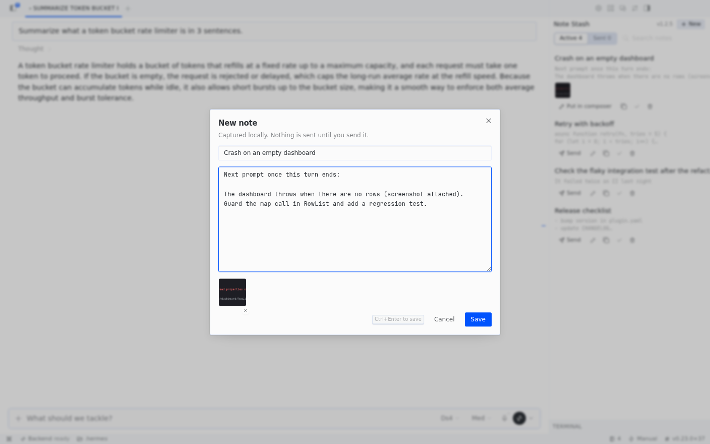
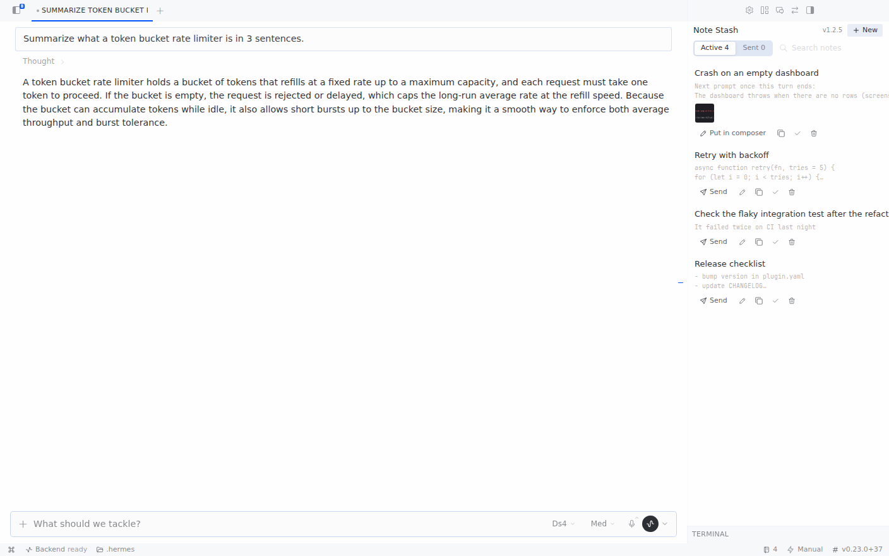
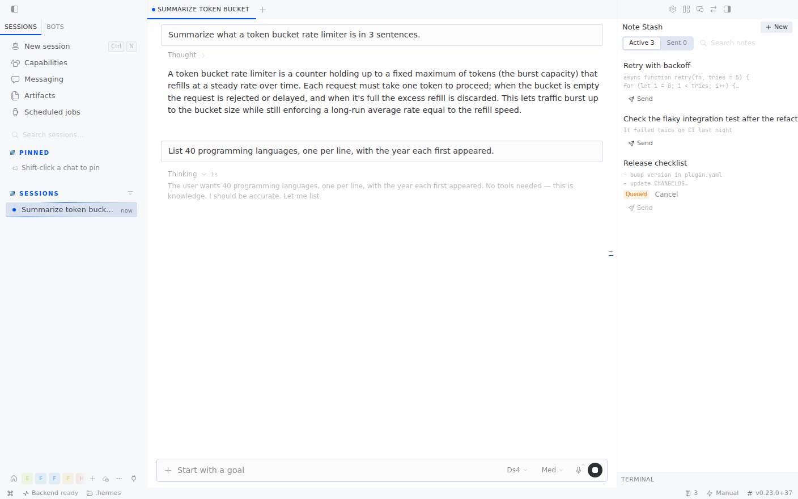
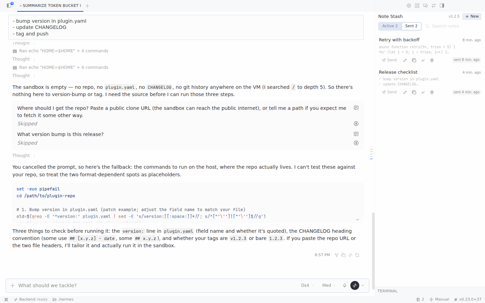

# Note Stash

Sticky notes and a code stash for Hermes Desktop. Capture a thought — prose or
code — **without interrupting the turn you are in**, then send it to the focused
session as the next prompt. A note sent to a session that is mid-turn is queued
until that turn ends instead of being injected into it. Capture never touches
the composer or the session: a note stays inside the plugin until you explicitly
send it, put it in the composer, or copy it.

## Screenshots









## Requirements

- Hermes Desktop.
- Hermes `>= 0.22.7` (the floor declared in `plugin.yaml`; `ctx.files` first
  ships in 0.22.7).

## Install

1. **From the catalog**, once listed:
   ```bash
   hermes plugins install note-stash
   ```
2. **From Git**, in the Desktop app: **Capabilities → Plugins → Install from
   Git**, and paste the repository URL
   `https://github.com/freemanconsulting/hermes-note-stash`.
3. **Manual**: copy `desktop/plugin.js` to
   `~/.hermes/desktop-plugins/note-stash/plugin.js`, then enable Note Stash in
   **Capabilities → Plugins**.

There is no build step and no dependencies: plain ESM, loaded uncompiled.

## Usage

- **Capture** — the status bar chip (shows the count of active notes), the
  ⌘K palette command **"Note Stash: New note"**, or the default keybind
  **⌘⌥S** on macOS / **Ctrl+Alt+S** elsewhere (the contributed, rebindable
  action `note-stash.new-note`, category *view*, so it also appears in
  **Settings → Keybinds**). The dialog has an optional title and a monospace
  body (a body or an image is required to save): **Tab** inserts two spaces,
  **⌘/Ctrl+Enter** saves, **Esc** cancels (it only asks to confirm when a draft
  would be lost). Paste or drop images into it (see "Images").
- **Pane** — a right-side pane (320px) listing notes with title/first line,
  relative time and status. Filter **Active** / **Sent**, search, and click a
  row to edit it inline. Per note:
  - **Send** — sends the body to the focused session as the next prompt. The
    button's tooltip and accessible label name the target:
    `Send to "<session title>"`, or `Send to this chat` when the focused session
    has no usable title. Disabled when there is no focused session, and for a
    note that is already sent or queued. If the target is mid-turn the note is
    queued (see "Why the busy queue").
  - **Put in composer** — appends the body to the focused session's existing
    draft (`host.composer.insertText(sid, body, { mode: 'block' })`, never
    clobbers it) and then focuses the composer; the note stays active. For a
    note with images this is the labeled action instead of **Send**: it adds the
    text and the images (see "Images").
  - **Copy** — copies the body to the clipboard. Text only, like **Put in
    composer**.
  - **Delete** — removes the note after a confirmation.
  - **Restore** — on a sent note, moves it back to Active (label: "Restore to
    active").
- **Send targets the session focused at click time**, never the session that
  was focused when the note was written.
- **Sent notes are kept** — in the **Sent** filter each row shows a
  `sent <time>` badge (e.g. "sent 5m ago") and has the **Restore** action.

## Images

Paste or drop PNG, JPEG, GIF, WebP or BMP images into the capture dialog or a
note editor. Each image is stored as one `img-<note>-<n>.txt` text file holding
its data URL in the plugin's own data folder, capped at ~3 MB per image. The
editor shows thumbnails with a remove button; a row shows up to three with a
`+N` count, and a missing file renders a placeholder instead of breaking the
row.

A note with images has **Put in composer** as its labeled action instead of
**Send**. It inserts the note's text into the chat you are viewing, then
dispatches a synthetic paste event carrying one image File per stored image;
Desktop's own paste handling turns that into real attachment chips in that
chat's composer, the same path as a real Cmd+V. Nothing is sent until you press
Enter. If the paste is not handled (an open dialog, or no composer to take it),
Note Stash shows an error and leaves the text it already added in place. An
images-only note adds just its images. **Copy** stays text-only.

## Why the busy queue

Hermes routes input sent mid-turn according to the `display.busy_input_mode`
setting (`interrupt`, `queue` or `steer`). Note Stash never sends into a running
turn whatever that setting is: it waits until the turn ends, waits a ~750 ms
settle delay, re-checks the busy flag, and then submits **one** note per idle
transition, FIFO per session. The next queued note waits for the next idle
transition, so a queued note's own turn has to finish first. A queued row shows
a **Queued** badge (tooltip: "Queued — sends when the turn ends") and a
**Cancel** action.

Desktop only submits to a chat that is on screen: `host.composer.submit` returns
false when the queued chat is not the focused one at the moment its turn ends.
That is not a failure. The note becomes **Waiting**, stays at the head of its
session's FIFO (later notes keep their order behind it), and sends itself once
that chat is focused again and idle — retried on a focus change, a busy change,
or a 3 s interval that runs only while a note waits. A note is marked sent only
after the chat actually starts the turn — `host.composer.submit` returning true
is not proof of delivery — and a just-opened chat gets ~1.5 s to settle before a
waiting note is sent. A waiting row shows a
**Waiting** badge (tooltip: "The chat was not on screen when its turn ended"),
a muted `Sends when you open “<title>”` line naming the chat from the title
cache, and **Cancel**. It never switches your view and never sends to another
session. A submit that fails on the immediate, not-busy Send path (the chat is
on screen, so this is a real error) still reports an error and leaves the note
active.

The queue is in memory only: queued and waiting notes revert to Active after an
app restart, so nothing auto-sends when the app comes back.

## Privacy and data

- **Storage.** Notes are stored as `notes.json` (`{version: 1, notes: [...]}`)
  in the plugin's own app data folder via `ctx.files`, written debounced
  (~300 ms) and verified after each write. If that folder is unavailable, the
  plugin falls back to its namespaced app storage (`ctx.storage`) for the rest
  of the session and shows one warning naming the failure. A missing or
  malformed `notes.json` is an empty store.
- **Images.** Image files are read and written only as `img-*.txt` files in the
  plugin's own data folder, one data URL per file. They leave the plugin only
  when you click **Put in composer** on a note with images: the plugin reads the
  stored data URL and dispatches a synthetic paste event carrying the image as a
  File; Desktop's own paste handling adds it to the chat on screen as an
  attachment. Nothing is sent until you press Enter. Nothing else reads or sends
  them.
- **No network calls and no third-party services.** The only session data the
  plugin reads is the focused profile's persisted-session list, through
  `host.listPersistedSessions` — a local read, no gateway dial — when the
  focused chat changes, and every 5 s only while the focused chat has no title
  yet; it also listens to the local Hermes gateway's `session.info` events to
  pick up title changes. It uses only session ids and titles, only to label the
  Send button; if that fails, the label falls back to `Send to this chat`.
- **Note text leaves the plugin only when you act.** Clicking **Send** submits
  the note body as a prompt to the focused session, which then goes to your
  configured model like any prompt you type. **Put in composer** inserts it into
  that session's draft; for a note with images it also adds the images to the
  composer as attachments, which are sent only when you press Enter. **Copy**
  writes it to the clipboard. Nothing else sends note text anywhere.
- **No telemetry**, no usage reporting, and no stored credentials.
- The plugin reads and writes no files outside its own data folder.

## Development

```bash
npm test
```

`test/` runs under `node --test` with zero npm dependencies. `test/loader.mjs`
installs a module-resolution hook that maps `@hermes/plugin-sdk`, `react` and
`react/jsx-runtime` to minimal stubs in `test/stubs/`, so the tests import the
real `desktop/plugin.js`. The pure logic — note reducers, the send-queue state
machine, persistence (de)serialization, title derivation — is exported as named
functions taking injected dependencies (`submit`, `isBusy`, timers, clock).

Covered: send-while-busy never submits and submits exactly once after
busy→idle + settle; FIFO across two queued notes waits for the second idle
transition; submit returning `false` holds the head note as Waiting silently and
retries on a focus change, a busy change or the 3 s interval; a submit that
returns true but never starts a turn goes back to Waiting after 8 s; a persisted
`queued` note loads as `active`; malformed/missing `notes.json` yields an empty
store; a refused (`protected`) file write falls back to `ctx.storage`, the notes
read back from storage, exactly one warning toast is raised, and later writes do
not re-warn; `dataUrlToFile` round-trips the bytes and mime of a stored data URL;
`putInComposerWithImages` inserts the text once, dispatches one paste with one
File per image and focuses, skips the insert for an images-only note, and
reports an error without focusing when the paste is not handled;
`previewFor` starts an untitled note's preview at its second line;
`titleFromRows` matches a title by session id or lineage root id;
`titleUpdateFromEvent` extracts a title from a `session.info` event. An i18n
completeness test checks every `t()` key against the registered English table,
and a render smoke test registers the plugin against a fake context, renders
every contribution, and executes component effects so a missing method called
from an effect fails the test.

## License

MIT — see [LICENSE](LICENSE).
